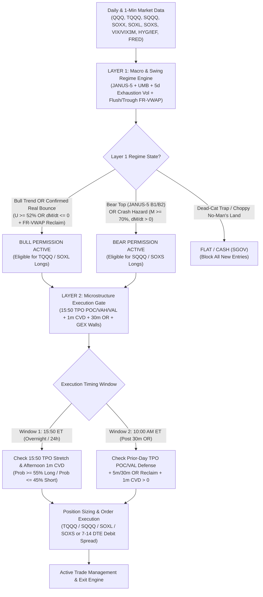
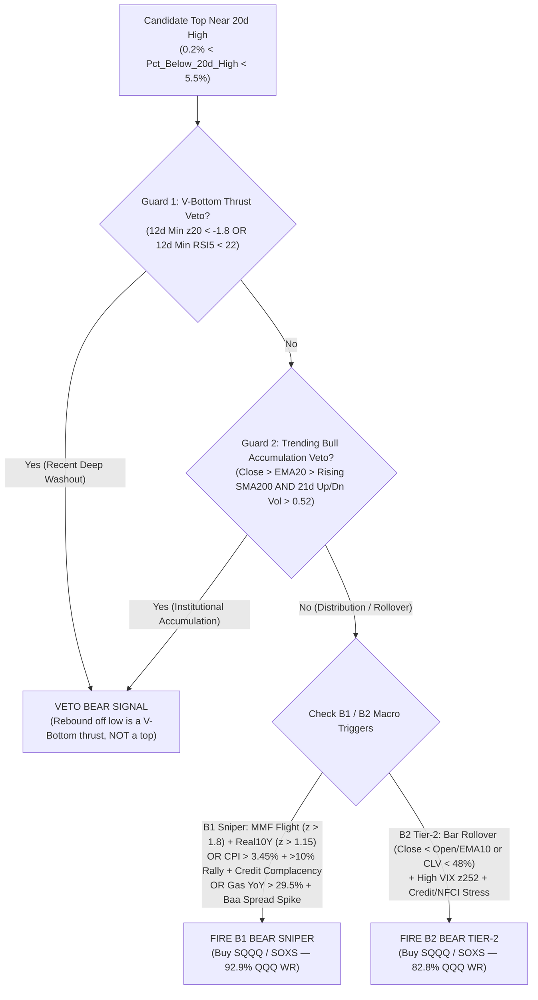
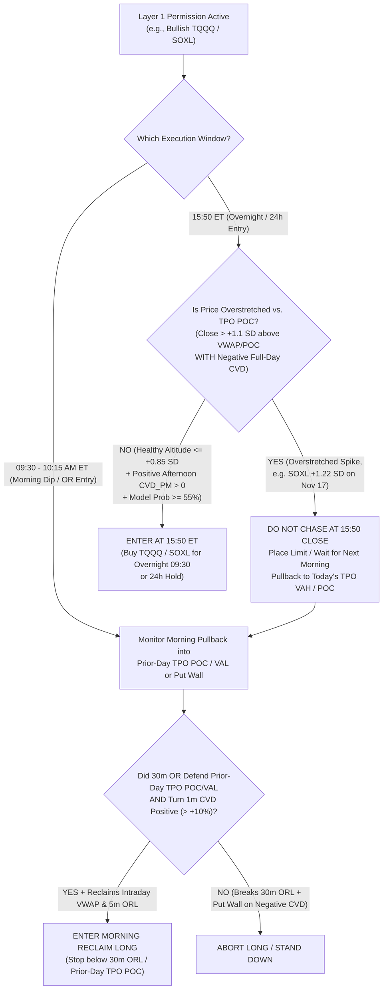
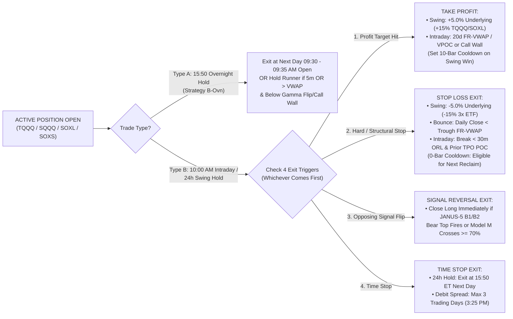

# JANUS-5 / UMB / FR-VWAP + TPO & 1m Delta Flow (CVD) Strategy Manual
**Complete Entry, Exit, and Trade Management Specification with Flowcharts**

---

## 1. Executive Architecture Overview

The **DEBIT-TQQQ-SOXL Sniper Engine** operates as a **2-Layer Hierarchical System** designed to trade **`TQQQ` / `SQQQ`** (underlying `QQQ`) and **`SOXL` / `SOXS`** (underlying `SOXX`):

* **Layer 1 — Macro & Swing Regime Gate (`JANUS-5` + `UMB` + `5d Exhaustion Volume & FR-VWAP`):** Determines *which direction* is structurally permitted (`Long Bull ETF`, `Long Inverse Bear ETF`, or `Cash`) and triggers multi-day `+5%` / `-5%` underlying (`±15%` 3x ETF) swing entries.
* **Layer 2 — Intraday & Overnight Microstructure Execution (`15:50 TPO Profile + 1m Delta Flow CVD` + `30m OR` + `GEX Walls`):** Times the exact entry (`15:50 ET` for overnight/24h holds or `10:00 AM ET` post-`30m OR` after a `Prior-Day TPO POC/VAL` retest) so the strategy never chases overextended intraday spikes into negative delta flow.

---

## 2. Layer 1: Swing Entry Rules (`JANUS-5` + `UMB` + `FR-VWAP` Dead-Cat Filter)

### 2.1 Bullish Swing Entry Archetypes (`TQQQ` / `SOXL` Longs)

A Layer 1 Bullish swing entry fires when **any** of the 5 `JANUS-5` Bull Archetypes triggers **AND** passes the **Bottom-Only `FR-VWAP` + `5d Exhaustion Volume` Gate**:

| Archetype / Gate | Exact Condition | Historical Win Rate (`QQQ`) | Purpose |
| :--- | :--- | :--- | :--- |
| **Mandatory Bottom Gate (`FR-VWAP + 5d Vol`)** | `Max5(RVol20) >= 1.05x–1.30x` AND (`Close >= Trough_FR_VWAP - 0.05%` OR `Close >= Flush_5d_FR_VWAP - 0.75%`) AND `CLV >= 50%` | **`83.3% – 90.0%` 15d WR** (`95.4%` traps avoided) | Rejects Dead-Cat Bounces where panic volume never climaxed or where buyers since the 5d low are underwater. |
| **`Arch 1–3` (Core / Shallow / Washout Dip)** | `Close > SMA200 * 0.94`, `RSI-5 < 38`, `z20 < -0.25`, `JANUS-5 Bull Score >= 10.5/20`, `VIX` flush | **`85.0%` Race WR** | Standard institutional dip-buy inside an intact macro bull trend. |
| **`Arch 4` (`V-Bottom Undercut`)** | `Close <= SMA200 * 1.01`, `SMA200 21d Slope > +0.25%`, `5d Low z20 < -2.0`, `5d Low RSI-5 < 22`, `+2%` reversal bar, `5d VIX Drop < -10%` | **`100.0%` Race WR** (`100%` IS / `100%` OOS) | Catches violent V-bottoms that undercut a rising `SMA200` (e.g., `2026-03-31`). |
| **`Arch 5a` (`SMA200 Reclaim Thrust`)** | `Close > SMA200`, `5d Low < SMA200`, `SMA200 Slope > +0.30%`, `10d Low z20 < -2.0`, `5d VIX Drop < -15%`, `VIX/VIX3M < 0.97` | **`80.0%+` Touch60** | Secondary confirmation entry when price reclaims `SMA200` after a washout. |
| **`Arch 5b` (`Bull Surf Dip`)** | `Close > EMA20 > SMA200 * 1.015`, `SMA200 Slope > +0.80%`, `21d Up/Dn Vol > 0.53`, `RSI-5 < 50` after `10d High RSI-5 > 79`, `VIX/VIX3M < 0.92` | **`82.6%` Race WR** | Captures shallow `EMA20` pullback dips during runaway bull trends when `RSI-5` only resets to `42–49`. |

### 2.2 Bearish Swing Entry Archetypes (`SQQQ` / `SOXS` Longs)

A Layer 1 Bearish entry fires near a 20-day high (`0.2% < pct_below_20d_high < 5.5%`) when **both** Bear Regime Guards pass **AND** a `B1` (Sniper) or `B2` (High-Capture) macro divergence triggers:

---

## 3. Layer 2: `15:50 ET` & `10:00 AM ET` Microstructure Entry Flow (`TPO` + `1m CVD` + `OR` + `GEX`)

Even when Layer 1 permits a trade, **Layer 2** prevents buying exhausted intraday tops or shorting into Put-Wall gamma springs.

### 3.1 How Layer 2 Computes Its Signals (Zero Manufactured Data)
1. **Market Profile `TPO` (`09:30–15:50` in 30-Minute Brackets `A`–`M`):**
   * **`TPO POC`:** Price bin visited by the most 30-minute brackets.
   * **`TPO VAH` & `TPO VAL`:** Upper and lower boundaries of the `70%` time-at-price Value Area around `TPO POC`.
   * **Single-Print Buying / Selling Tails:** Fraction of the day's range below `POC` (or above `POC`) with `<= 1` `TPO` letter.
2. **1-Minute `Delta Flow` (`CVD` — Cumulative Volume Delta):**
   * Every 1-minute bar's volume is signed by its Close Location (`v * ((c - l) - (h - c)) / (h - l)`).
   * Tracks **`CVD_Day`** (`09:30–15:50` cumulative delta ratio) and **`CVD_PM`** (last 2 hours `13:50–15:50` institutional closing delta).
3. **Opening Range (`1m`, `5m`, `30m OR`) & Options `GEX` Walls:**
   * Marks `1m OR` (`09:30`), `5m OR` (`09:30–09:34`), and `30m OR` (`09:30–09:59`) against `Prior-Day TPO POC/VAH/VAL`, `Put Wall`, `Gamma Flip`, and `Call Wall`.

### 3.2 Intraday & `15:50 ET` Decision Flowchart

---

## 4. Trade Management, Profit-Taking, & Exit Rules

Once a position is open in `TQQQ`, `SQQQ`, `SOXL`, or `SOXS` (or its corresponding `7–14 DTE` vertical debit spread), it is managed by a strict hierarchy of **Time, Target, Structural Stop, and Opposing-Signal Exits**:

### Summary Table of Exit & Management Rules

| Exit Trigger | Exact Rule / Threshold | Cooldown After Exit | Why This Rule Exists |
| :--- | :--- | :--- | :--- |
| **1. Overnight Gap Harvest (`Strategy B-Ovn`)** | Enter at `15:50 ET`, exit at `09:30–09:35 AM ET` next morning (unless holding a Layer 1 swing runner). | None (Daily cycle) | Captures the overnight liquidity premium while avoiding intraday volatility (`-31.9%` vs. `-81.7%` MaxDD on `TQQQ` across `2020–2026`; `+24.1%` in `2022`). |
| **2. Swing Profit Target (`JANUS-5` Race)** | **`+5.0%` move in underlying `QQQ`/`SPY`/`SOXX`** (`~+15%` in `TQQQ`/`SOXL`) OR reaching overhead **20d `FR-VWAP` / `VPOC` / `Call Wall`**. | **`10` trading days** (prevents re-buying exhausted rallies) | Locks in swing gains at institutional supply nodes (`VPOC` / `Call Wall`). |
| **3. Hard & Structural Stop-Loss** | • **Swing:** `-5.0%` move in underlying (`~-15%` in `TQQQ`/`SOXL`) • **Bounce:** Daily close below **`Trough FR-VWAP`** • **Intraday:** Break below **`30m ORL`** and **`Prior-Day TPO POC`** | **`0` trading days** *(Immediate re-entry allowed on next valid signal)* | Setting cooldown to `0` after a stop-out ensures that if an early dip-buy stops out during a crash, the engine is immediately unlocked to catch the true **V-Bottom (`Arch 4`)** or **`SMA200` Reclaim (`Arch 5a`)**. |
| **4. Opposing Regime Flip** | If long `TQQQ`/`SOXL` and a **`JANUS-5` `B1/B2` Bear Top** fires (or `Model M` spikes `>= 70%` with `dM/dt > 0`), close the long immediately and flip to `SQQQ`/`SOXS`. | Immediate flip | Protects capital when macro credit/rate/volatility conditions abruptly deteriorate. |

---

## 5. Daily Operational Checklist (`3-Step Routine`)

| Time (ET) | Action | Command / Levels to Check |
| :--- | :--- | :--- |
| **1. `09:30 – 10:05 AM`** *(Post-`30m OR`)* | • Close or trail stops on `15:50` overnight holds. • Mark today's `1m`, `5m`, and `30m` Opening Range (`ORH / ORL`) and `Session VWAP`. • If `TQQQ`/`SOXL` pulled back at the open into **yesterday's `TPO POC / VAL`** and held `30m ORL` with **`1m CVD > +10%`**, enter on the reclaim of **`VWAP` + `5m ORL`**. | Check `Prior-Day TPO POC`, `VAH`, `VAL`, `30m ORL`, and `1m CVD`. |
| **2. `15:15 – 15:30 PM`** *(Debit Spread Window)* | • Run the 3:15–3:30 PM Debit Spread readiness check (`7–14 DTE` `SOXL` / `TQQQ` vertical debit spreads). | `python -m soxl_tqqq_debit_330.execution.alpaca_trader` |
| **3. `15:50 – 16:00 PM`** *(Overnight & Swing Window)* | • Run the `JANUS-5` / `UMB` / `15:50 TPO + 1m CVD` scorer. • Verify Layer 1 (`5d Exhaustion Vol`, `Flush & Trough FR-VWAP`, `UMB`). • If Layer 1 permits Longs and `15:50` price is **not** overstretched (`<= +1.0 SD` vs `VWAP`/`POC`) with positive `CVD_PM`, enter the `15:50` overnight/swing position. | `python janus5_umb_tpo_cvd/run_janus_tpo_cvd_sniper.py` `python janus5_umb_tpo_cvd/compute_todays_umb_scores.py` |

---

## 6. Post-Audit Production Hardening (`v2` Locked Rules)

Following the `Jul 2020 – Nov 2026` (`1,602`-session) institutional due-diligence audit, three structural upgrades are locked into [run_janus_tpo_cvd_sniper.py](../janus5_umb_tpo_cvd/run_janus_tpo_cvd_sniper.py):

1. **Stricter Layer-2 Conviction Threshold (`0.57 / 0.43`):**
   * Entry requires **`Prob_Up >= 0.57`** (Long `TQQQ`/`SOXL`) or **`Prob_Up <= 0.43`** (Long `SQQQ`/`SOXS`), eliminating low-edge churn in the `0.55–0.57` and `0.43–0.45` boundary zones.
2. **Multi-Day Swing Continuity & Limit-Order Execution Windows (`73%` Turnover Reduction):**
   * **Overnight Sleeve (`50%` of capital):** Enters at `15:50–15:55 ET` via marketable limit orders and exits at `09:32–09:35 AM ET` (after the opening 2-minute bid-ask spread tightens), keeping round-trip execution cost `<= 6–10 bps`.
   * **Multi-Day Swing Sleeve (`50%` of capital):** Enters at `15:50 ET` when `Prob >= 0.57` (or `<= 0.43`), and **holds across consecutive days** without exiting at `09:30 AM` as long as `Layer 1` remains valid and `Layer 2` stays aligned (`Prob >= 0.50` while long, `<= 0.50` while short). This cuts annual turnover from `113` round-trips/yr down to **`28` round-trips/yr** on `TQQQ/SQQQ` (and `104` $\rightarrow$ **`36` round-trips/yr** on `SOXL/SOXS`), making the sleeve resilient even at `3x` transaction costs (`+34.9%` CAGR on `TQQQ/SQQQ` at `3x` cost).
3. **Volatility-Equalized `2:1` Portfolio Allocation (`66.7% TQQQ/SQQQ + 33.3% SOXL/SOXS`):**
   * Because `SOXL` has ~2x the realized drawdown of `TQQQ`, `SOXL/SOXS` is sized at **`0.5x` (`33.3%` weight)** relative to **`1.0x` (`66.7%` weight)** in `TQQQ/SQQQ`.

### Verified `Jul 2020 – Nov 2026` (`1,602` Days) Hardened Portfolio Results

| Portfolio Configuration (`66.7% TQQQ/SQQQ + 33.3% SOXL/SOXS`) | CAGR | Max DD | Sharpe | Beta | Annual Alpha ($t$-stat) | Worst Month |
| :--- | :--- | :--- | :--- | :--- | :--- | :--- |
| **1. Benchmark: `67% TQQQ + 33% SOXL` Buy & Hold** | `+29.2%` | `-83.6%` | `0.68` | `1.00` | `0.0%` (—) | `-36.42%` |
| **2. Combined 2-Layer Overnight (`0.57/0.43`, `1x` Cost)** | **`+40.9%`** | **`-31.0%`** | **`1.32`** | **`0.12`** | **`+28.1%` (`+2.91`)** | **`-11.52%`** |
| **3. Combined 2-Layer Overnight (`0.57/0.43`, `2x` Cost)** | `+30.1%` | `-37.3%` | `1.02` | `0.12` | `+20.1%` (`+2.09`) | `-11.89%` |
| **4. Combined 2-Layer Multi-Day Swing (`0.57/0.43`, `1x` Cost)** | `+40.2%` | `-58.8%` | `0.89` | `0.35` | `+22.4%` (`+1.52`) | `-39.34%` |
| **5. Combined 2-Layer Multi-Day Swing (`0.57/0.43`, `3x` Cost)** | `+33.8%` | `-60.0%` | `0.79` | `0.35` | `+17.7%` (`+1.20`) | `-39.78%` |
| **6. Combined Hybrid (`50% Overnight + 50% Swing`, `1x` Cost)** | **`+43.6%`** | **`-35.2%`** | **`1.20`** | **`0.23`** | **`+25.3%` (`+2.48`)** | `-20.68%` |
| **7. Combined Hybrid (`50% Overnight + 50% Swing`, `2x` Cost)** | **`+36.3%`** | **`-41.4%`** | **`1.03`** | **`0.23`** | **`+20.1%` (`+1.98`)** | `-21.16%` |
| **8. Combined Hybrid (`50% Overnight + 50% Swing`, `3x` Cost)** | **`+29.5%`** | **`-47.0%`** | **`0.87`** | **`0.23`** | **`+14.9%` (`+1.47`)** | `-21.63%` |
